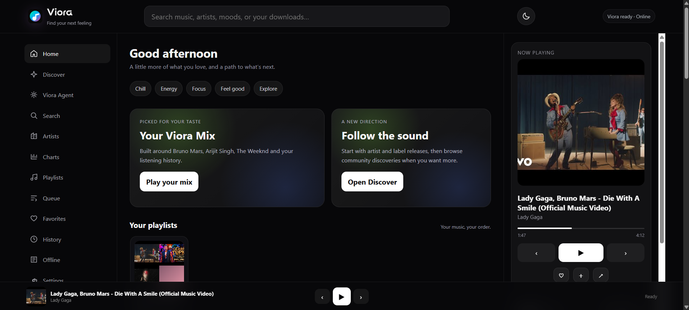

# Viora

**Find your next feeling.**

Viora is a local-first music discovery and listening app. It brings together personalized discovery, search, a persistent library, playlists, optional offline listening, regional charts, and a music assistant grounded in your listening data.

## What Viora includes

- **A home shaped by your taste.** First-run setup collects favorite artists, genres, languages, moods, and discovery preference. You can revisit it in Settings.
- **Music discovery.** Browse artist and creator results, community uploads, similar tracks, mood shelves, and Continue Listening. Likely official sources are ranked before community uploads using available metadata signals; the labels are not a guarantee of rights or ownership.
- **Charts.** Browse the official Apple Music regional Top 50 and Top 100 feed, open official YouTube Music weekly and daily charts and Spotify Charts, and choose up to 12 cards. Viora also builds on-device most-played and favorites charts from this user's own library. Genre, mood, language, and activity cards are clearly labeled Viora discovery mixes, not measured rankings.
- **A working queue.** See the current track and upcoming songs together. Play a queued song, remove it, shuffle, save the queue as a playlist, or clear upcoming tracks. Queue and player state update while you listen.
- **Playlists and imports.** Create, rename, reorder, shuffle, and play Viora playlists. Import CSV, M3U/M3U8, JSON, or text track lists, or paste copied song names. Viora matches tracks in the background and reports unmatched songs.
- **Saved service playlists.** Keep playlist links or iframe embeds from Spotify, Apple Music, YouTube Music, Amazon Music, Tidal, Deezer, and SoundCloud in a permanent, editable section on the Playlists page. Open supported players in Viora's full-screen playlist view; its Now Playing area shows the playlist name and provider logo. Spotify and YouTube playback state is reflected automatically; other providers offer a manual listening-status control when their embeds do not expose playback events.
- **Local library and offline playback.** Download tracks where you have permission, browse local files, detect missing files, and use Auto, Online, or Offline playback modes.
- **Personal recommendations.** Viora ranks real local or searched tracks using taste, favorites, history, recency, and novelty signals. It does not invent song titles or send listening data to a hosted AI model.
- **A retrieval-grounded music agent.** Ask Viora to find, play, queue, save, or recommend music, or to summarize your local listening context. The assistant uses local intent handling and retrieval; it is not a hosted generative model.
- **A responsive listening space.** Use Viora in desktop or mobile browsers, install it as a PWA on supported browsers, and use Space, Left Arrow, and Right Arrow for playback controls. Animated background color waves respond to playback and can be turned off in Settings.
- **Persistent personal data.** SQLite stores library metadata, playlists, favorites, history, taste, recent searches, settings, and agent conversation. Use Settings to back up or restore the database.
- **A full Now Playing view.** Expand the current song, use playback controls, and stop the active track while keeping the upcoming queue. Idle screens include a prompt instead of a blank player.

## Download Viora

Viora is distributed in two parts because GitHub does not accept an individual file larger than 100 MB:

- **Full Windows bundle:** use the Viora ZIP shared in the [Viora Telegram community](https://t.me/+A-WF1i2q7aJhMzQ9). It includes `mpv.exe` with the Viora files, so you do not need to upload the large MPV executable to GitHub.
- **GitHub project:** download the source ZIP from GitHub for the latest project files. The GitHub source archive does not include MPV or other large third-party runtime executables; get the matching MPV runtime bundle from Telegram or install MPV separately.

Use the Viora release post in Telegram for the full bundle and check its version against the GitHub release before combining files. Do not extract one release over a different version.

## Quick start on Windows

Requirements:

- Windows 10 or 11
- Python 3.10 or newer
- MPV and yt-dlp for online playback. MPV is included in the full Telegram bundle; GitHub source downloads do not include it.
- Internet access for online search, streaming, provider previews, and chart refreshes

1. Download and extract the full Viora ZIP from the official Telegram release post, or download the source ZIP from GitHub and obtain MPV separately as described above. Extract Viora to a folder you can write to.
2. Install Python dependencies with **python -m pip install -r requirements.txt**.
3. If using the full bundle, keep the included MPV files together in its `runtime` folder and set `MPV_PATH` in `.env` to the full path of that `mpv.exe`. If using the GitHub source ZIP, install MPV or extract it to `C:\mpv\mpv.exe`. Viora launches the configured executable directly, so MPV does not need to be added to PATH. For online playback, yt-dlp is also required; set `YTDLP_PATH` in `.env` if it is not at `C:\mpv\yt-dlp.exe`.
4. Start Viora with START_VIORA.bat or START_VIORA.vbs.
5. Open http://127.0.0.1:8888 in your browser.
6. In Settings, choose Install Viora or Add to Home Screen where your browser supports it.

Viora binds to the local device by default. It does not require Ollama. The GitHub source code does not include MPV or yt-dlp media executables; the full Telegram bundle includes MPV, and the release post should state whether yt-dlp is bundled too.

### Build a Windows app folder

On a Windows build computer, install the packages in requirements-build.txt and run build_windows.ps1 in PowerShell. The script creates dist/Viora. It copies MPV and yt-dlp into the app when those executables are available on the build computer; otherwise they must be installed on the target device. Keep the third-party license and notice files with redistributed binaries. The build is an app folder, not a signed installer.

The source ZIP can be recreated on Windows with package_release.ps1. The release process excludes .env, virtual environments, Git data, databases, downloads, logs, cache files, third-party runtime executables, and the personal-use Surgena font.

## Save playlists from other services

Open **Playlists → Saved service playlists** and paste a playlist sharing link or its official iframe embed code. Optionally give it a name, open the in-app player, and save it. Saved links stay in Viora's local library and can be renamed, edited, deleted, opened full screen where embedding is supported, or opened in the original service. The database backup includes these saved links.

Viora recognizes Spotify, Apple Music, YouTube/YouTube Music, Amazon Music, Tidal, Deezer, and SoundCloud playlist links. Spotify, Apple Music, and YouTube offer supported player embeds; Amazon Music and other providers are saved as links and open in their own app or website. Spotify and YouTube expose playback-state events that Viora can reflect. For services that do not share those events, use the manual listening-status control. A provider may restrict playback by region, account, subscription, or browser settings.

Viora does not sign into these services, read private account libraries, or extract track lists from cross-origin embed players. To make a native Viora playlist, import a CSV, M3U/M3U8, JSON, or text track list, or paste copied song names. This needs no developer key or service password.

## Mobile and Android

The interface is responsive and the web app can be installed from supported mobile browsers as a PWA. A native Android APK is not included. An APK release would require an owned HTTPS domain, Android build and signing tools, Digital Asset Links for a Trusted Web Activity, and separate device testing. The current mobile experience remains a browser-based app.

## Move or back up your data

Use Settings → Move or protect your library to download a Viora database backup, then restore it in another Viora installation. The database backup includes profile, playlists, library metadata, favorites, listening history, recent searches, settings, and agent conversation. Audio files are stored separately; copy the offline downloads folder separately and update its location in Settings if needed.

Source and packaged builds use the same per-user data location by default: %LOCALAPPDATA%\Viora on Windows. This keeps the profile consistent across source runs, browser installs, and the packaged Windows app on the same PC.

## Privacy and service notes

- Personal Viora data stays in the local database on the device running Viora. Online search, streaming, chart refresh, artist image lookup, and provider embeds contact their respective services when used.
- Artist starter images are retrieved from Wikipedia page thumbnails when online. Image rights vary by source, and available images link to their reference pages.
- Apple Music regional chart data is a daily official most-played feed and links back to Apple Music. YouTube Music Weekly Top Songs and Daily Top Music Videos and Spotify Charts open at their official chart pages. Viora does not scrape their private or account-specific data.
- Viora's own most-played and favorites charts are calculated from this device's SQLite library; they are personal charts, not a combined or public Viora ranking. Genre and mood mixes are search-based discoveries, not chart counts.
- YouTube source classification is a local metadata heuristic. Check a result's channel and rights before saving or downloading it.
- Only download music when you have the rights and permission to do so, and follow each source service's terms.
- The supplied Surgena font is marked Personal Use Only and is excluded from releases.

## Keyboard shortcuts

| Key | Action |
| --- | --- |
| Space | Play or pause |
| Left Arrow | Previous track |
| Right Arrow | Next track |

Shortcuts pause while a text field, button, or other interactive control has focus.

## Project files

- README.md — product and setup guide
- ROADMAP.md — implemented work and remaining platform tasks
- RELEASE_NOTES.md — current release summary
- SECURITY.md — local service security notes
- LICENSE — MIT License for the project code

Viora is an independent project and is not affiliated with Spotify, Apple Music, YouTube, or MPV.
